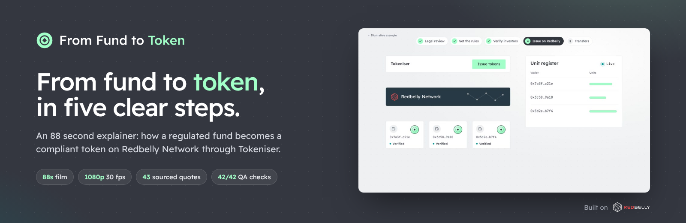
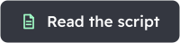
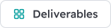
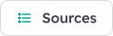
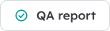
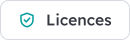
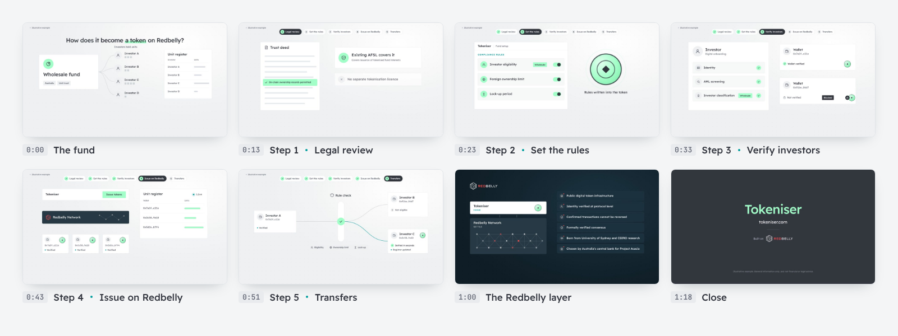
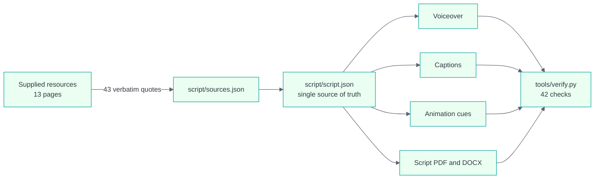

<p align="center">
  
</p>

<p align="center">
  
  
  
  
  
  
</p>

<p align="center">
  <a href="deliverables/tokenisation-explainer-1080p-captions.mp4"></a>
  &nbsp;
  <a href="deliverables/tokenisation-explainer-script.pdf"></a>
</p>

<p align="center">
  <a href="#deliverables"></a>
  <a href="docs/sources.md"></a>
  <a href="docs/qa-report.md"></a>
  <a href="licences/README.md"></a>
</p>

<br>

**From Fund to Token** is an 88 second animated explainer that shows, step by step and in plain language, how a regulated fund becomes a compliant token on Redbelly Network through Tokeniser.

It follows one illustrative Australian wholesale fund, structured as a unit trust, through the five steps Tokeniser documents in its own Knowledge Hub. Every claim about Redbelly or Tokeniser is backed by a verbatim quote from the resources supplied with the brief, and the whole chain from source to screen is checked automatically.

Made for the Redbelly DAO Community Task Board, for use in Tokeniser marketing, on the DAO website and in the Start Here hub.

<p align="center">
  
</p>

## Contents

- [Deliverables](#deliverables)
- [The film](#the-film)
- [Accuracy](#accuracy)
- [Design](#design)
- [Repository structure](#repository-structure)
- [Build from source](#build-from-source)
- [Verification](#verification)
- [Licences](#licences)

## Deliverables

| | Deliverable | Files | Format |
|:-:|---|---|---|
| 1 | **Script** for fact checking | <a href="deliverables/tokenisation-explainer-script.pdf"></a> <a href="deliverables/tokenisation-explainer-script.docx"></a> | Line by line voiceover, on screen text, visuals and verbatim sources |
| 2 | **Final video**, captions burned in | <a href="deliverables/tokenisation-explainer-1080p-captions.mp4"></a> | 1920 x 1080, 30 fps, H.264, AAC 48 kHz |
| 2 | **Final video**, clean | <a href="deliverables/tokenisation-explainer-1080p-clean.mp4"></a> <a href="deliverables/tokenisation-explainer.srt"></a> <a href="deliverables/tokenisation-explainer.vtt"></a> | Same master without captions, plus subtitle files |
| 3 | **Project files** | [`animation/`](animation/) · [`audio/`](audio/) · [`script/`](script/) · [`tools/`](tools/) · [`brand/`](brand/) | Full source, rebuilds the film from scratch |
| 4 | **Licence proof** | [`licences/`](licences/README.md) | OFL 1.1 for both fonts, Apache 2.0 for the voice model, brand kit record |

> [!TIP]
> [`index.html`](index.html) is a ready to host web page for the film, with chapters, a captions switch and every download. It is plain static HTML, so Vercel, Netlify or GitHub Pages serve it with no build step.

## The film

| Time | Chapter | What the viewer learns |
|:--|:--|:--|
| `0:00` | **The fund** | A wholesale fund in Australia. Investors hold units on a register. How does it become a token on Redbelly? |
| `0:07` | **Today** | Registers sit across separate systems, checks are manual, settlement takes days. |
| `0:13` | **Step 1** Legal review | The trust deed is checked for on chain ownership. The existing licence covers it, with no separate tokenisation licence. |
| `0:23` | **Step 2** Set the rules | On Tokeniser, the manager sets who can invest, foreign ownership limits and lock-up periods. The rules are written into the token. |
| `0:33` | **Step 3** Verify investors | Identity, anti-money laundering screening and investor classification come first. No tokens until then. |
| `0:43` | **Step 4** Issue on Redbelly | Tokens are issued on Redbelly Network into verified wallets. The register is live from the first token. |
| `0:51` | **Step 5** Transfers | Every transfer is checked against the rules first. Break a rule and it is rejected. Pass and it settles in seconds. |
| `1:00` | **The Redbelly layer** | Public digital token infrastructure, identity verified at protocol level, final transactions, formally verified consensus, Project Acacia. |
| `1:18` | **Close** | Same fund, same strategy, same licence. Now its units are compliant tokens on Redbelly, through Tokeniser. |

The full script with timecodes, on screen text and visual notes is in [`script/script.md`](script/script.md).

| Spec | Value |
|---|---|
| Runtime | 88.2 seconds |
| Video | 16:9, 1920 x 1080, 30 fps, H.264 High profile, yuv420p, fast start |
| Audio | AAC 48 kHz stereo, -16 LUFS integrated, -1.5 dBTP ceiling, music ducked under speech |
| Captions | 26 cues, word synced, at most two lines of 42 characters, burned in and as SRT and VTT |
| Voice | Kokoro 82M, voice `af_heart`, generated locally (Apache 2.0) |
| Music | Original, generated in code for this project |

## Accuracy

The film is accurate by construction. One script file drives everything a viewer sees and hears.



1. **Sources.** [`script/sources.json`](script/sources.json) holds 43 verbatim quotes from 13 pages of the supplied resources, read on 26 October 2026.
2. **Evidence per line.** [`script/script.json`](script/script.json) ties every voiceover line to the exact quotes that support it, and every factual on screen label to its sources. Where a line simplifies, a note says how.
3. **No drift.** The voiceover, captions, animation cues and script document are all generated from that file.
4. **Checked twice.** [`tools/verify.py`](tools/verify.py) checks the whole chain. With `--online` it re-reads every source page and confirms each quote is still there, word for word.

Some things the resources mention stay out of the film on purpose: prices, market sizes, cost savings, liquidity promises, and throughput figures that differ between pages. They are listed in [`docs/sources.md`](docs/sources.md).

## Design

| Layer | Source | Applied as |
|---|---|---|
| Look and feel | Tokeniser website | Light surfaces, deep slate bands, mint accent for verified and settled states |
| Type, colour, logos | Redbelly brand kit and manual | Readex Pro throughout, official Redbelly logo files, Redbelly red only on the Redbelly layer |
| Voice and craft | DAO Task Board brand kit | Plain copy, no em dashes, no emoji, no hype words, monospace only for machine values |

Full notes in [`docs/brand-application.md`](docs/brand-application.md).

## Repository structure

```
.
├── deliverables/   Final videos, subtitles, script PDF and DOCX
├── script/         script.json, sources.json, timeline.json, readable script.md
├── animation/      Deterministic HTML and SVG scenes, rendered frame by frame
├── audio/          Voiceover takes, original music bed, final mix
├── subtitles/      Captions as JSON, SRT and VTT
├── tools/          Build, render, mix, encode, document and verification scripts
├── brand/          Design tokens, fonts, official Redbelly logos
├── web/            Project logo (SVG), poster and README images
├── docs/           Brief and checklist, production plan, brand notes, sources, QA report
├── licences/       Licence register, licence texts, provenance records
├── index.html      Static web page for the film and downloads
└── vercel.json     Serves .md, .srt and .vtt as readable text on Vercel
```

## Build from source

**Requirements:** Python 3.10 to 3.12, Node.js 18 or later with Playwright and Chromium, FFmpeg.

```bash
python3.12 -m venv .venv
.venv/bin/pip install torch --index-url https://download.pytorch.org/whl/cpu
.venv/bin/pip install -r requirements.txt
.venv/bin/pip install --no-deps https://huggingface.co/spacy/en_core_web_sm/resolve/main/en_core_web_sm-any-py3-none-any.whl
npm install playwright && npx playwright install chromium

PYTHON=.venv/bin/python tools/build_all.sh            # rebuild everything, then verify
PYTHON=.venv/bin/python tools/build_all.sh --online   # also re-check every quote on the live pages
```

To preview the animation without rendering, open [`animation/index.html`](animation/index.html) in a browser and add `#play` to the address, or `#t=45` to jump to a moment.

<details>
<summary><b>Run each step on its own</b></summary>

<br>

| Step | Command | Output |
|---|---|---|
| Voiceover and timeline | `python tools/build_voiceover.py` | `audio/voiceover/`, `script/timeline.json`, `animation/timeline.js` |
| Music | `python tools/build_music.py` | `audio/music/` |
| Captions | `python tools/build_subtitles.py` | `subtitles/` |
| Frames | `node tools/render_frames.js --out build/frames --captions build/captions` | PNG frames and caption overlays |
| Mix | `python tools/mix_audio.py` | `audio/final_mix.flac` |
| Encode | `python tools/encode_video.py --frames build/frames --captions build/captions` | `deliverables/*.mp4`, `.srt`, `.vtt` |
| Script document | `python tools/build_script_doc.py` then `node tools/html_to_pdf.js build/script.html deliverables/tokenisation-explainer-script.pdf` | PDF, DOCX, `script/script.md`, `docs/sources.md` |
| Logo | `python tools/build_logo.py` (needs fonttools, brotli, uharfbuzz) | `web/logo-light.svg`, `web/logo-dark.svg`, `web/mark.svg` |
| README buttons | `python tools/build_readme_buttons.py` | `web/buttons/*.svg` |
| README images | `node tools/build_readme_media.js` | `web/readme-banner.png`, `web/readme-storyboard.png` |
| Verify | `python tools/verify.py [--online]` | `docs/qa-report.md` |

</details>

## Verification

[`tools/verify.py`](tools/verify.py) fails the build if any check fails. The latest run passed **42 of 42**. Full results are in [`docs/qa-report.md`](docs/qa-report.md).

| Area | What is checked |
|---|---|
| Deliverables | Every required file and licence text is present |
| Video | H.264 MP4, 16:9, at least 1080p and 24 fps, 60 to 90 seconds, matches the timeline |
| Audio | AAC stereo 48 kHz, about -16 LUFS, true peak below -1 dBTP |
| Captions | Match the script word for word, two lines of 42 characters at most, no overlaps, at least 1.2 s each |
| Sources | Every spoken line has verbatim evidence, every factual label names a known source, all sources are supplied resources |
| Consistency | Text rendered in the animation equals the script's on screen text, scene by scene. Every motion cue found its spoken word |
| Copy rules | No em or en dashes, emoji, hype words, price or return language, or personal credit |
| Live sources | With `--online`, all 43 quotes are found again on the live pages |

## Licences

| Asset | Licence |
|---|---|
| Readex Pro, JetBrains Mono | SIL Open Font License 1.1 |
| Kokoro 82M voice model | Apache License 2.0 |
| Redbelly Network logos | Official brand kit, used unmodified under the brand guidelines |
| Music, icons, illustration, animation, project logo | Original to this project |

No stock footage, photography, music or voice is used anywhere. Licence texts and provenance records are in [`licences/`](licences/README.md).

> [!NOTE]
> The fund in the film is an illustrative example. General information only, and not financial or legal advice.
